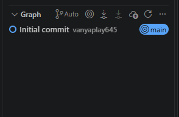
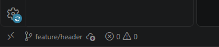
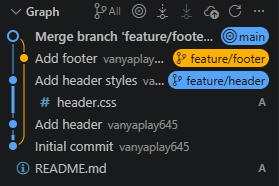

# Практика веток

## Задание 3.3
Чтобы узнать текущую ветку нахождения пользователя, нужно посмотреть в нижнюю панель VS Code, а точнее в левый угол:

## Задание 4.3

- Не вижу header.html и footer.html в проводнике, они находятся в отдельных ветках, в ветке main на которую я сейчас переключился их нет. 
- При переключении ветки, файлы спрятались в скрытую папку .git в зашифрованном формате в подпапке objects.

## Задание 5.2

